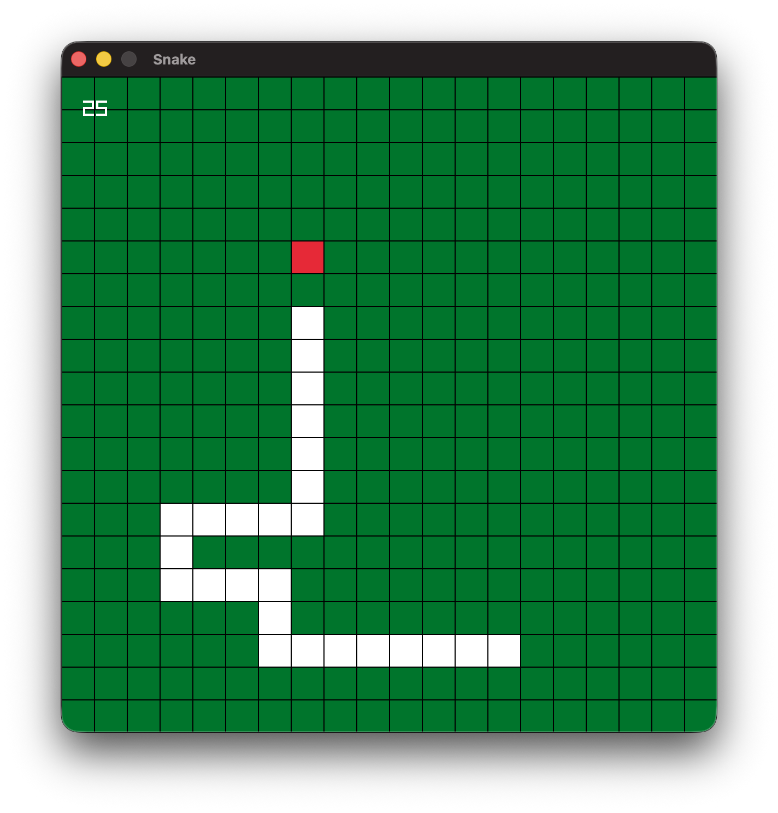

# Snake

A simple Snake game written in C++ using [raylib](https://www.raylib.com/).

I built this project as a small exercise for myself. I enjoy coding and figuring out how to implement things myself. Snake is a simple game, which makes it a great project code in a small amount of time and have some fun.

## Requirements

- C++ compiler with C++17 support
- CMake 4.1 or newer
- Raylib 5.5   

## Building and Running

Clone the repository:

```bash
git clone https://github.com/punthenk/snake.git
cd snake
```

Create a build directory and configure the project:

```bash
mkdir build
cd build
cmake ..
```

Build and run the game:

```bash
make run
```

You can now play snake! Enjoy!
